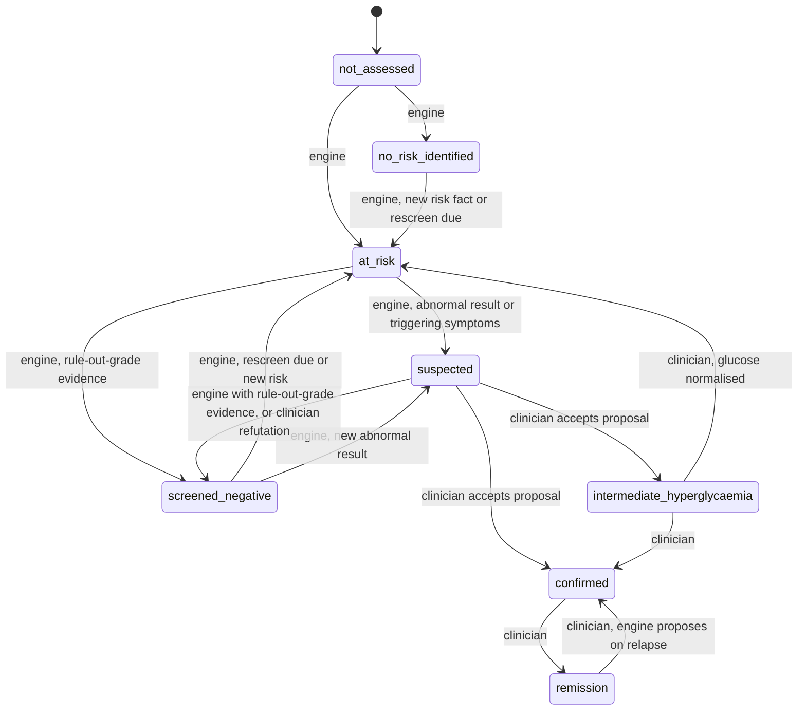

# MedSync — NCD Engine Framework and Diabetes Pack Structure v1.0

### Condition profiles that suspect, confirm, classify, stratify and act

> **Doc ID** MS-NCD-ENG-001
> **Status** DRAFT for GATE A: CSO sign-off (intended use, invariants, state ownership, proposal eligibility) and engineering review (read model, pipeline, budgets). Stage 1: drafted, checked against section [18], revised.
> **Pairs with** MS-DATA-CFC-001 (Clinical Fact Contract) and `clinical-fact-concepts.v1.json`.
> **Next** MS-NCD-DM-DOSSIER-001 (Gate 2: every REF-DM reference filled from verified sources and signed), then PROMPT-NCD-ENGINE.md (Gate 3).
> **Rule** This document contains no clinical threshold. Every number is a named reference (REF-DM-…) that the dossier fills and verifies and the CSO signs, the discipline the resus catalogues already use. Values in wireframes and vignettes are illustrative patient data, not thresholds.

---

## [00] What this is

A framework for condition profiles, and the structure of its first pack: diabetes. The framework is condition-agnostic, so hypertension, chronic kidney disease (CKD) and the rest of the NCD catalogue become new packs on the same core. Diabetes goes first because it exercises every lane.

Three facts shaped the design.

- **Most of the work is finding people who feel well.** In the IDF Africa Region, 72.6% of adults with diabetes are undiagnosed (IDF Diabetes Atlas 2025). In Uganda, high blood glucose rose from 1.5% in 2014 to 3.3% in 2023 across the two national STEPS surveys, while high blood pressure held at about a quarter of adults.
- **A single normal test does not rule diabetes out here.** In a sub-Saharan community screening study, fasting glucose alone missed 44.4% of the diabetes cases that fasting glucose and the 2-hour OGTT found together. HbA1c is unusable or unreliable for a large share of Ugandan patients (MS-DATA-CFC-001, 4.2).
- **The patients generic engines miss are predictable.** Children in diabetic ketoacidosis (DKA) treated as malaria; lean young adults with insulin-deficient diabetes; people on dolutegravir; women in pregnancy.

## [01] Intended use (draft for the regulatory file)

> MedSync condition profiles are clinician-facing decision support. The software assembles facts already recorded in MedSync into guideline-referenced profiles and proposes next steps (tests, screening, referral, individual targets, recall) for a qualified clinician to accept or decline. It does not diagnose, prescribe, dose or act without clinician confirmation, and it is not intended for patients to assess themselves. Signals of acute danger are handed to the triage, resuscitation and monitoring engines, which own emergency response.
>
> Users: registered clinicians, by cadre as decided at GATE A. Settings: MedSync facilities at every level of the Ministry of Health (MoH) ladder. Population: all ages; for patients under 16, version 1 is limited to recognition, classification support and referral.

**Regulatory posture.** The wording keeps outputs at "propose; the clinician decides". That is consistent with the read-and-alert posture already adopted for the bionic islet work, and with keeping the patient app signpost-only. The intended-use statement determines the software's risk class, so it is signed before any build, and any later change of wording (therapy suggestions in v1.1, for example) re-opens classification.

**DPPA 2019, section 27.** A patient can require that decisions significantly affecting them are not based solely on automated processing. No NCD output takes effect without a clinician, so the design meets this by construction.

## [02] Where it sits in the build

Proposed insertion into Tier 3 of the master roadmap:

1. Encounter/EMR engine, carrying MS-DATA-CFC-001 as its data phase (next).
2. Monitoring/vitals engine and alerts.
3. Notifications engine.
4. **Condition intelligence: the NCD engine with the diabetes pack** (new).
5. Care-team shared workspace, which then consumes profile targets as shared goals.

The engine-first law applies as written. The pure engine package and its own tables, with RLS and tests, can be built as soon as the fact contract exists; no user-facing surface reads them until the EMR and monitoring engines are real. Design review can use a dev-only fixture preview that is never deployed to users; that is a stated exception, raised for decision (D-NCD-15) rather than assumed.

## [03] Architecture

```
patient model ─┐
EMR ───────────┤
monitoring ────┼─▶ fact tables ─▶ loadFactSnapshot(manifest, asOf) ─▶ FactSnapshot
hospital setup ┘                                                        │
                                                                        ▼
         ┌──────────────────────── lib/ncd (pure, no I/O) ────────────────────────┐
         │ core/derive      BMI, waist-to-height, eGFR, BP set means, CVD inputs   │
         │ packs/diabetes   suspect → confirm → classify → stratify → act          │
         │ state/reducer    engine versus clinician ownership, invariants          │
         │ proposals        stable keys, deduplication, snooze                     │
         │ explain          evidence, citations, data gaps, copy keys              │
         └──────────────────────────────────┬─────────────────────────────────────┘
                                            ▼
            ncd_profiles · ncd_profile_events · ncd_proposals · ncd_runs · ncd_outbox
                                            ▼
   Doctor Workspace · profile drawer · monitoring targets · recalls · Centre plan tier · registry
```

- `lib/ncd` has no runtime dependencies beyond Zod and no Node APIs, so the same code runs in Next.js server actions, Supabase Edge Functions (Deno) and, later if needed, Expo.
- The engine is a pure function: `evaluate(snapshot, pack, priorProfile, clinicianDecisions, now) → ProfileResult`. The same inputs give the same output, byte for byte.

## [04] Pack format

Logic lives in code; numbers live in signed catalogues. There is no generic rules language: a rules DSL would be harder to test, harder to review and easier to break than typed predicates with unit tests.

```ts
export interface PackManifest {
  id: 'diabetes'; version: string;                   // semver
  status: 'draft' | 'shadow' | 'cso_signed' | 'retired';
  signedBy?: string; secondReviewer?: string; signedAt?: string;   // four-eyes, see [13]
  reads: ConceptId[];                                // the loader manifest (least privilege)
  criteriaSets: CriteriaSetId[]; defaultCriteriaSet: CriteriaSetId;
  rules: RuleDef[];
}

export interface RuleDef {
  id: string;                                        // 'DM-SUS-INCID-01'
  family: string;                                    // 'DM-SUS-INCID'
  lane: 'suspect' | 'confirm' | 'classify' | 'stratify' | 'act' | 'acute_route';
  title: string;                                     // plain language, sentence case
  appliesTo: { ageBandRef?: RefId; sex?: 'female' | 'male';
               pregnancy?: 'pregnant' | 'postpartum' | 'not_pregnant' | 'any' };
  reads: ConceptId[];
  predicate: PredicateId;                            // implemented in TypeScript, unit-tested
  params: Record<string, RefId>;                     // pointers into the signed reference catalogue
  minTrust: 1 | 2 | 3 | 4;                           // MS-DATA-CFC-001, C6
  emits: Array<'state' | 'flag' | 'proposal' | 'data_gap' | 'acute_signal'>;
  citations: Array<{ source: string; section: string; url: string; verifiedOn: string }>;
  status: 'draft' | 'cso_signed' | 'retired';
}

export interface RefEntry {                          // the same shape as the resus reference catalogues
  id: string;                                        // 'REF-DM-FPG-DIAG'
  text: string; value?: number | string; unit?: string;
  source: string; url: string; verifiedOn: string;
  confidence: 'high' | 'moderate' | 'low'; status: 'draft' | 'cso_signed';
}
```

**Criteria sets.** Guidelines disagree, so criteria are named bundles of references and every profile states which set it used. Candidates for the dossier: `UG-UCG-2023` (default for Uganda), `WHO-HEARTS-D-2020`, `ADA-2026`, `IDF-2024-1H` (the 1-hour post-load criteria) and `WHO-2025-PREGNANCY`.

**Signing.** A pack runs in production only when its manifest and every reference it uses are `cso_signed`. Unsigned packs run in shadow mode only.

## [05] Shared cardiometabolic core

Computed once per snapshot and shared by every cardiometabolic pack:

- **Anthropometry:** BMI for adults, BMI-for-age for children (v1.1), waist, waist-to-height ratio, mid-upper arm circumference.
- **Blood pressure:** reading-set means and the latest valid set.
- **Kidney:** eGFR by the signed equation with its label, ACR category, and position on the KDIGO grid (numbers from the dossier).
- **Lipids:** latest valid panel and non-HDL cholesterol.
- **Behaviour:** tobacco, alcohol, physical activity.
- **Cardiovascular risk inputs** for the WHO risk chart for the Eastern sub-Saharan Africa region, using the laboratory or non-laboratory version depending on the data available.
- **Medicine classes:** on glucose-lowering, blood-pressure-lowering or statin treatment, or on glucose-raising medicines.

Hypertension, CKD and CVD packs reuse all of this; after diabetes, a hypertension pack is mostly configuration.

## [06] Diabetes pack v1

### 6.1 Scope

| Population | v1 scope |
|---|---|
| Adults, 16 and over (the platform cut-off) | All lanes |
| Children under 16 | Suspect, classification support, acute routing and referral. No management content, matching the platform's under-16 rule. |
| Pregnancy | Antenatal screening, hyperglycaemia first detected in pregnancy, postpartum follow-up (WHO 2025 guideline on diabetes in pregnancy) |
| Known diabetes, transferred in without evidence | Confirmed on the clinician's assertion; "diagnostic evidence not on record" shown as a data gap |

Out of scope in v1: therapy and dosing suggestions of any kind (the proposal kind is reserved for v1.1, with its own sign-off and a classification review), insulin titration and paediatric management.

### 6.2 Lanes and rule families

Every number used by these families is a dossier reference (REF-DM-…).

| Family | Lane | Purpose | Main inputs |
|---|---|---|---|
| DM-SUS-RISK | suspect | A risk tier for people without known diabetes: routine, soon or today. It is a points-based tier, not a probability, because non-invasive scores are poorly calibrated in African populations until they are recalibrated. Candidates for the dossier: the African Diabetes Risk Score (ADRS, the only tool reported as developed in sub-Saharan Africa), FINDRISC, and the UCG and WHO PEN screening criteria. | age, BMI, waist, blood pressure and its treatment, family history, activity, diet, prior high glucose, prior hyperglycaemia in pregnancy |
| DM-SUS-INCID | suspect | Incidental hyperglycaemia: a glucose above a reference with no follow-up test or diagnosis within a window. Probably the highest-yield rule in the pack. | glucose history, conditions, later tests |
| DM-SUS-SYMP | suspect | Symptom-triggered testing in adults | polyuria, polydipsia, weight loss, blurred vision, recurrent infections |
| DM-SUS-POP | suspect | Special populations: dolutegravir, boosted protease inhibitors, systemic glucocorticoids, metabolic antipsychotics, active TB (bidirectional screening), pancreatitis or pancreatic surgery, PCOS, prior hyperglycaemia in pregnancy, cardiovascular disease, hypertension | drug tags, conditions, pregnancy history |
| DM-SUS-INPT | suspect | Inpatient hyperglycaemia: separating stress hyperglycaemia from unrecognised diabetes with a valid HbA1c | setting, glucose, HbA1c validity |
| DM-SUS-RECON | suspect | On a glucose-lowering medicine with no diabetes on the problem list: propose reconciliation (it may be PCOS, prediabetes or a missing entry) | drug tags, conditions |
| DM-SUS-PAED | suspect | Children with weight loss, polyuria, secondary enuresis, Kussmaul breathing, dehydration without diarrhoea or altered consciousness: test glucose today and route acute features | findings, vital signs, age |
| DM-CON-CRIT | confirm | Apply the named criteria set to valid results | glucose with context, HbA1c with validity |
| DM-CON-REPEAT | confirm | Confirmation logic: repeat testing, same-sample concordance, symptoms plus a random glucose | results, findings |
| DM-CON-VALID | confirm | Assay and sample validity: HbA1c modifiers, meter limits, delayed processing, trust | MS-DATA-CFC-001, 4.1 and 4.2 |
| DM-CON-DISC | confirm | Discordant results: which test to do next | results, capabilities |
| DM-CON-PREG | confirm | Hyperglycaemia first detected in pregnancy: gestational diabetes versus diabetes in pregnancy | OGTT time points, gestation |
| DM-CLS-T1 | classify | Features of insulin deficiency: young onset, ketosis, weight loss, low BMI | age, ketones, findings, BMI; C-peptide and antibodies where available |
| DM-CLS-ATYP | classify | A lean, insulin-deficient phenotype with a history of undernutrition: flag "atypical, don't assume type 2" and propose specialist review. Never labels type 5 while the IDF's diagnostic criteria are being developed. | BMI, MUAC, undernutrition history, ketones |
| DM-CLS-DRUG | classify | Drug-associated hyperglycaemia | drug tags and their timing |
| DM-CLS-PANC | classify | Pancreatogenic diabetes | pancreatitis, pancreatic surgery |
| DM-STR-CTRL | stratify | Control against the individual target: at target, above target, or unknown (no valid measure in the window) | HbA1c with validity, fructosamine, glucose series, CGM summaries |
| DM-STR-HYPO | stratify | Hypoglycaemia burden and risk context | events, insulin or sulfonylurea tags, eGFR, age |
| DM-STR-CKD | stratify | Position on the KDIGO grid, with the eGFR caveat and the repeat requirement | eGFR, ACR |
| DM-STR-EYE | stratify | Retinal screening status and grade | procedures, retinopathy grade |
| DM-STR-FOOT | stratify | IWGDF risk category and examination interval | foot examination facts |
| DM-STR-CVD | stratify | WHO chart risk band; established cardiovascular disease | core CVD inputs |
| DM-STR-NEURO | stratify | Neuropathy screening status | monofilament, vibration sense, symptoms |
| DM-STR-CMPL | stratify | Complication summary. It feeds the plan tier only after clinician confirmation. | all stratify outputs |
| DM-ACT-TEST | act | Next-best test (6.3) | capabilities, validity, state |
| DM-ACT-SCREEN | act | Book due screening for eyes, feet and kidneys | stratify outputs, capabilities |
| DM-ACT-REFER | act | Referral: diabetes clinic, endocrinology, paediatrics, antenatal, eye, foot | state, flags, capabilities |
| DM-ACT-TARGET | act | Propose individual targets for clinician approval. Approved targets become monitoring thresholds. | age, hypoglycaemia risk, pregnancy, comorbidity |
| DM-ACT-RECALL | act | Recall and rescreen dates | state, intervals |
| DM-ACT-EDU | act | Self-management education and nutrition referral | state, capabilities |
| DM-ACU-ROUTE | acute_route | Context-aware acute signals, for example ketosis in a patient on an SGLT2 inhibitor with near-normal glucose. Routed, never managed. | glucose, ketones, findings, drug tags, vital signs |

### 6.3 Next-best test

For a patient who needs testing, candidate tests are ranked on four factors, in this order:

1. **Valid for this patient.** An HbA1c is excluded when a modifier makes it unusable.
2. **Available here now.** Capability status, including `intermittent`.
3. **Expected yield** given the current state. For example, an OGTT when fasting glucose is normal but risk is high.
4. **Patient burden.** Fasting, a second visit, cost to the patient.

The weights are signed in the dossier. Each ranked test carries a one-line reason the interface can show.

## [07] State model

### 7.1 Diagnostic axis

| State | Meaning | Owner |
|---|---|---|
| `not_assessed` | Cannot be evaluated yet (no date of birth, for example) or never evaluated | engine |
| `no_risk_identified` | Evaluated; nothing in the recorded data meets screening criteria. Shows completeness; never says "low risk". | engine |
| `at_risk` | Screening indicated; tier routine, soon or today | engine |
| `screened_negative` | Valid negative testing, graded `full` or `limited` (fasting glucose alone in a high-risk patient, for example), with a rescreen date | engine, only with evidence that meets the criteria set's rule-out grade |
| `suspected` | Abnormal, indeterminate or symptom-triggered; needs confirmation | engine |
| `intermediate_hyperglycaemia` | Confirmed intermediate hyperglycaemia | clinician |
| `confirmed` | Confirmed diabetes, with type and flags | clinician |
| `remission` | Type 2 diabetes in remission, by consensus criteria | clinician |



Ownership rules:

- The engine never enters `intermediate_hyperglycaemia`, `confirmed` or `remission`. It proposes; a clinician accepts.
- A clinician who adds diabetes directly to the problem list moves the profile to `confirmed` even without evidence on record (transfers, referral letters). The missing evidence then shows as a data gap.
- A clinician's refutation stands until new evidence is recorded after it. The engine does not nag.
- The engine never downgrades `confirmed`. It can propose reclassification (type 2 to type 1 when ketosis recurs, for example) or remission.

### 7.2 Control axis (confirmed diabetes only)

`unknown` (no valid measure in the recency window, which is not the same as controlled), `at_target` or `above_target`. Each carries the measure used, its date, its validity and the individual target. Hypoglycaemia burden is shown alongside, never averaged away.

### 7.3 Complication axis (per organ)

For kidneys, eyes, feet, heart and nerves: `not_screened`, `screen_overdue`, `screened_normal` (with the next due date), `abnormal_pending_confirmation` or `confirmed` (with stage). Only clinician-confirmed complications feed the Cardiometabolic Centre plan tier.

### 7.4 Overlays and flags

- **Pregnancy episode:** screening due, then screened, then hyperglycaemia first detected (suspected), then gestational diabetes or diabetes in pregnancy (clinician), then postpartum follow-up due, then resolved or converted. A resolved episode keeps the patient `at_risk`, with periodic rescreening.
- **Flags:** `atypical_phenotype`, `drug_associated`, `hba1c_unusable` (with its reason), `evidence_not_on_record`, `acute_signal_sent`, `data_quarantined`.

## [08] Proposals and intents

| Kind | Example | Intent on acceptance | Eligible cadres (proposed; GATE A) |
|---|---|---|---|
| `test.order` | Order a fasting glucose | `order_lab` | medical officer (MO), clinical officer (CO), specialist; nurse or midwife for point-of-care tests where facility policy allows |
| `test.repeat` | Repeat the HbA1c to confirm | `order_lab` | as above |
| `diagnosis.confirm` | Confirm type 2 diabetes (criteria set named) | `add_problem`, authored by the accepting clinician | MO, CO, specialist |
| `diagnosis.reclassify` | Review the type: features of insulin deficiency | `review` | MO, specialist |
| `screening.book` | Book retinal screening | `book` | any clinician, nurse |
| `refer` | Refer to the diabetes clinic | `refer` | MO, CO, specialist |
| `target.set` | Propose individual targets | `set_monitoring_target` (monitoring engine) | MO, CO, specialist |
| `recall.schedule` | Rescreen after the interval set in the dossier | `schedule_recall` | any clinician |
| `education.offer` | Self-management education | `refer` | any clinician, nurse |
| `reconcile.problem_list` | On metformin with no diabetes on the problem list | `review` | MO, CO |
| `data.correct` | An implausible value or unit | opens the correction flow | author, supervisor |
| `therapy.review` | Reserved for v1.1 | none | none |

Clinical officers lead most HC IIIs and carry much of the outpatient work at HC IVs. Leaving them out of diagnosis confirmation would switch the product off where most patients are seen. The final list follows the open GATE A decision on co-sign sets and override authority by cadre.

**Intents.** Accepting a proposal creates a pending intent of the same shape the triage recommendations layer already uses; the workflow execution layer runs it once that layer exists. The NCD engine never writes to the problem list, orders or prescriptions itself: `diagnosis.confirm` opens the EMR's own write path with the clinician as author and `assertedBy = 'engine_proposal_accepted'`.

**Declining.** Every decline takes one reason: `patient_declined`, `not_available_here`, `done_elsewhere` (which prompts entry of the result), `not_clinically_indicated`, `duplicate` or `data_incorrect` (which opens the correction flow). The reason decides when the proposal may return: after its snooze window (a dossier reference), when a capability becomes available, or when new evidence arrives. Decline reasons are also the main validation signal.

**Deduplication.** Each proposal has a stable key made from the pack, kind, target and parameters, so the same proposal never stacks.

## [09] Outputs and read model

### 9.1 The profile payload is the UX contract

A stunning interface is designed into the payload, not painted on afterwards. The engine emits everything the surface needs, precomputed, so the drawer renders instantly and the browser never works out clinical meaning.

```ts
export interface ConditionProfile {
  condition: 'diabetes'; packVersion: string; criteriaSet: string;
  asOf: string; computedAt: string; inputsHash: string; freshness: 'current' | 'stale';
  diagnostic: {
    state: DiagnosticState; since: string; owner: 'engine' | 'clinician';
    tier?: 'routine' | 'soon' | 'today'; grade?: 'full' | 'limited' | 'clinical';
    rescreenDue?: string; type?: DmType; typeBasis?: 'confirmed' | 'suggested';
  };
  hero?: { label: CopyKey; value: EvidenceValue; target?: TargetBand; trend: 'up' | 'down' | 'flat' | 'insufficient' };
  control?: {
    state: 'unknown' | 'at_target' | 'above_target'; measure?: EvidenceValue; target?: TargetBand;
    series: Array<{ concept: ConceptId; points: Array<[string, number]>; band?: TargetBand }>;  // pre-bucketed, at most 60 points
    hypoglycaemia?: { events30d: number; highestLevel?: 1 | 2 | 3 };
  };
  complications?: Record<'kidney' | 'eyes' | 'feet' | 'heart' | 'nerves', ComplicationView>;
  flags: FlagView[];
  why: Explanation[];            // every statement traceable to rules and facts
  proposals: ProposalView[];     // ordered; proposals[0] is the single primary action
  dataGaps: DataGap[];           // ranked by what they would change
  journey: JourneyEvent[];       // state changes, decisions and corrections (paged)
  completeness: { score: number; missingCore: ConceptId[] };
  containsRestricted: boolean;
}

export interface Explanation {
  statement: { key: CopyKey; params: Record<string, string | number> };   // localisable, CSO-signed copy
  ruleId: string; criteriaSet?: string;
  citation: { source: string; section: string; url: string };
  evidence: EvidenceItem[];
}

export interface EvidenceItem {
  factId: string; concept: ConceptId;
  role: 'supports' | 'argues_against' | 'context' | 'invalidates';
  value: EvidenceValue;          // display-ready: value, unit, effective date, age label
  trustBadge: 'lab' | 'point_of_care' | 'clinician' | 'device' | 'patient';
  usableForDiagnosis?: { ok: boolean; reasonKey?: CopyKey };
  restricted: boolean; provenanceRef: string;
}

export interface DataGap {
  concept: ConceptId; reasonKey: CopyKey;
  wouldChange: Array<'diagnostic' | 'type' | 'control' | 'kidney' | 'eyes' | 'feet' | 'heart' | 'tier'>;
  availableHere: 'yes' | 'intermittent' | 'no'; rank: number;
}
```

### 9.2 Tables

```sql
ncd_packs           (id, version, status, manifest jsonb, signed_by, second_reviewer, signed_at)   -- pk (id, version)
ncd_profiles        (patient_id, condition, pack_version, criteria_set, diagnostic_state, control_state,
                     type, flags text[], profile jsonb, completeness numeric, next_review_at,
                     inputs_hash, as_of, computed_at, run_id)                                      -- pk (patient_id, condition)
ncd_profile_events  (id, patient_id, condition, kind, from_state, to_state, actor, actor_id,
                     reason_code, payload jsonb, run_id, created_at)                               -- append-only
ncd_proposals       (id, patient_id, condition, key, kind, status, priority, due_at, rationale jsonb,
                     intent jsonb, eligible_cadres text[], created_run, resolved_by, resolved_at,
                     resolution_reason, snooze_until)                                               -- unique (patient_id, key) while open
ncd_runs            (id, patient_id, pack_versions jsonb, inputs_hash, as_of, trigger, duration_ms,
                     outcome, error_code, created_at)                                              -- append-only
ncd_recompute_queue (patient_id primary key, reason, enqueued_at, not_before)
ncd_outbox          (id, topic, payload jsonb, created_at, delivered_at)
```

- **RLS.** Reads use the shared patient-access predicate (MS-DATA-CFC-001, 3.5). There are no client writes: the worker writes through a service role inside an Edge Function, and clinicians act only through `ncd_resolve_proposal(id, action, reason)`, a security-definer function that checks auth, `aal2`, cadre eligibility and patient access, writes the event and the audit entry, and enqueues a recompute.
- **Immutability.** `ncd_profile_events` and `ncd_runs` block UPDATE and DELETE by trigger, like the audit log.

## [10] Compute pipeline and budgets

1. A fact inserted into any source table enqueues the patient (an upsert into the queue with a short debounce).
2. A worker takes due patients with `for update skip locked`, loads the snapshot for the pack manifest, evaluates, compares with the current profile, and writes profile, events, proposals, run and outbox rows in one transaction.
3. Supabase Realtime tells an open drawer that its profile changed; RLS still applies.
4. A nightly sweep handles time: rescreen dates, overdue screening, expired snoozes, the incidental-hyperglycaemia search, and re-evaluation after a pack version change (in shadow mode first).
5. Idempotent: if the pack versions and the inputs hash are unchanged, nothing is written.
6. On failure the worker retries with backoff. After repeated failure the run is recorded as an error, the profile keeps its last good version marked stale, and an integrity alert goes to the facility admin.
7. Local development runs the worker as a `pnpm` script on the existing `prisma dev` setup; production uses Supabase scheduled functions. No new software is required.

| Budget | Target |
|---|---|
| Engine evaluation, 2,000-fact snapshot | ≤ 25 ms p95 |
| Snapshot load | ≤ 60 ms p95 |
| Fact written, to profile visible in an open drawer | ≤ 5 s p95 |
| Nightly sweep, 50,000 patients | ≤ 30 min on one worker |
| Profile payload | ≤ 24 KB gzipped |

## [11] UX blueprint

The build prompt at Gate 3 turns this into phased UI work. The decisions here are the ones that must be fixed before any code is written.

### 11.1 Brief

- **Audience:** medical officers, clinical officers, nurses, midwives and specialists across the MoH facility ladder, often between patients and sometimes on low-end Android devices.
- **Primary job:** know where this patient stands on diabetes and do the next right thing in under ten seconds.
- **Secondary job:** trust the answer. Every claim sits one tap from its evidence.

### 11.2 Design plan

The design system (DESIGN-medsync.md) is fixed; this plan applies it.

- **Colour.** Tokens only; no new colours.
  - Teal is action: buttons, links and focus.
  - Plum is place: the "you are here" marker on the journey rail, per ADR 0097.
  - The status trio is reserved for clinical signals. Green means at target. Amber means above target, suspected or overdue. Grey means pending, unknown or not assessed.
  - Red never appears on NCD surfaces. An acute signal appears as a link to the triage or resus item, which carries its own red. An invariant test enforces this, as it does across the platform.
- **Type.** Fraunces for exactly two things per profile: the condition name and the hero value. Geist for everything else, with tabular numerals for every value. No monospace for data. Headings at weight 500.
- **Layout.**
  - A right-hand drawer (520 px) on desktop and a full-height sheet on mobile.
  - Text left-aligned, numbers right-aligned, on the 4 px grid.
  - Sections use the house bracket numbers because they form a real reading sequence: why, control, complications, next steps, what would sharpen the picture, journey.
- **Signature.** The boldness goes into one place, the trajectory header. The hero value sits in Fraunces on a hairline target band, with the journey rail beneath it and the plum marker showing where the patient is. Everything below stays quiet: hairline dividers, no cards inside cards, and no shadows beyond the drawer's own elevation.
- **Checked against generic defaults.** The first idea was a dashboard of KPI tiles, which read like any SaaS template, so it became one header and typographic sections. Also removed:
  - dot-joined metadata strings;
  - all-caps labels;
  - arrow glyphs on buttons;
  - identical rounded cards;
  - gradient washes.

  Colour never carries meaning alone: every status has an icon and a word.

### 11.3 Surfaces

**S1: condition line in patient headers** (Workspace row, clerking page, encounter). Glyphs stand for icons from the product icon set; the patient is illustrative.

```
Amina Nakato    52 F    MRN 004812
[◆ Type 2 diabetes   ▲ Above target]   [◆ Hypertension   ✓ At target]   [2 care gaps]
```

Each pill opens the drawer at that condition. Care gaps are counted here, not listed.

**S2: profile drawer.** Illustrative data; braces mark values that come from signed references or the clinician's plan.

```
┌──────────────────────────────────────────────────────────────┐
│ Type 2 diabetes                                        Close │  Fraunces
│ Confirmed by Dr A. Okello on 14 Mar 2026                     │
│                                                              │
│   8.4 %                  ▲ Above target  {individual target} │  hero value, Fraunces
│   ───────────▔▔▔▔▔▔▔▔▔▔▔──────●                              │  target band and trend
│   HbA1c    Lab    12 Mar 2026    3 weeks ago                 │
│                                                              │
│   At risk ── Suspected ── Confirmed ── Above target ●        │  journey rail, plum marker
│                                                              │
│   [ Book retinal screening ]                    Not now ▾    │  the one primary action
├──────────────────────────────────────────────────────────────┤
│ [01] Why                                                     │
│   Supports   Fasting glucose    8.1 mmol/L    Lab   12 Mar   │
│   Supports   Fasting glucose    7.6 mmol/L    Lab   26 Feb   │
│   Context    Family history     Mother                       │
│   Rule DM-CON-CRIT-02     UCG 2023, section 8.1.3     Open   │
│ [02] Control                                                 │
│   HbA1c over 12 months against the target band (inline SVG)  │
│   2 low-glucose episodes in 30 days; highest level 2         │
│ [03] Complications                                           │
│   Kidneys   G3a A2          Abnormal once; repeat to confirm │
│   Eyes      Not screened    Due now                          │
│   Feet      IWGDF 1         Examined 2 months ago            │
│   Heart     {WHO chart band}                                 │
│ [04] Next steps                                              │
│   Book retinal screening            Book       Not now ▾     │
│   Repeat urine ACR                  Order      Not now ▾     │
│ [05] What would sharpen this                                 │
│   No lipid panel on record. It would change the heart band.  │
│ [06] Journey                                                 │
│   14 Mar  Confirmed by Dr Okello (accepted proposal)         │
│   12 Mar  Second fasting glucose 8.1 mmol/L, Lab             │
│   26 Feb  Suspected: fasting glucose 7.6 mmol/L, Lab         │
│   02 Feb  At risk: age 52, BMI 31, mother has diabetes       │
└──────────────────────────────────────────────────────────────┘
```

Two evidence rows the pattern must handle (illustrative):

```
│   Not used   HbA1c              7.9 %         Lab   12 Mar   │
│              Can't be used for diagnosis: sickle cell trait  │
│   Context    Dolutegravir since 2019                    🔒   │
```

A value that cannot be used is shown, struck from the reasoning and explained, never hidden. Restricted facts carry a lock icon as a reminder that they never appear in patient-facing views.

**S3: Doctor Workspace.** The Workspace law holds: each patient appears once, in one lane, with one next action.

- NCD adds a care-gap badge to the patient's existing row.
- It registers a source for the future Tasks lane through `lib/workspace/lanes.ts`. A patient appears in Tasks only when no other lane holds them, with their top proposal as the row's action.
- A batch review mode serves clinic sessions ("Review 12 routine care gaps"). Keys: J and K move, A accepts, D declines with a reason, E opens the evidence.

**S4: panel view** (Cardiometabolic Centre and heads of department; v1.1).

- Shows the cohort by state (at risk, suspected, confirmed, at target), overdue screening and the distribution of control, with drill-down to patient lists for the care team.
- Aggregates suppress small cells. Geography appears only under the separate epidemiological consent.

**S5: patient "My plan"** (mobile, behind GATE CG).

- Appears only after a clinician confirms.
- Shows targets in words and colour together, recent readings with in-range feedback, the next check date and education.
- Shows no risk labels before confirmation and no restricted reasons, ever.
- Keeps the persistent emergency affordance on every screen.
- SMS recalls are neutral by default ("Your health check is due at {facility} on {date}"). Naming the condition is opt-in.

### 11.4 Interaction rules

- **Evidence rows.** Tapping one opens its provenance: who recorded it, where, method, specimen, fasting state, device or laboratory, effective and recorded times, and trust.
- **Citations.** A citation opens the guideline section (the UCG 2023 PDF at the cited page).
- **Actions.** A primary action runs its intent. "Not now" opens the reason sheet, and the row collapses with a five-second undo.
- **State changes.** If the state changes while the drawer is open, the plum marker slides to its new position and the new journey entry appears. This is the one orchestrated motion: 180 ms, and off under reduced motion. Nothing else animates.
- **Empty sections.** An empty section is an invitation to act, never a blank.
  - "No HbA1c on record. HbA1c is the quickest way to confirm or rule out diabetes for this patient. [Order HbA1c]"
  - Where HbA1c is unusable: "HbA1c can't be used for this patient: sickle cell trait on record. Use fasting glucose or an OGTT. [Order fasting glucose]"
- **Stale or failed updates.** These say so plainly.
  - "Updated 3 hours ago. Refreshing."
  - "The profile couldn't update. Showing the version from 09:14. The error has been logged."

### 11.5 Copy rules

- Sentence case throughout.
- Buttons say exactly what happens: "Book retinal screening", "Order HbA1c", "Refer to diabetes clinic".
- Person-first language:
  - "above target", not "uncontrolled";
  - "not assessed" or "no risk identified", never "low risk" when data are missing;
  - "person with diabetes", never "diabetic" as a noun.
- Every value shows its unit, date and age.
- Every string is a copy key, signed by the CSO like all clinical screen copy, in English (UK) first. Luganda and other languages wait for a clinical translation review process, which does not exist yet.

### 11.6 Quality floor

- WCAG 2.2 AA, with a visible teal focus ring and full keyboard operation.
- A screen-reader summary at the top of the drawer: "Type 2 diabetes, confirmed. Above target: HbA1c 8.4 percent, 3 weeks ago. Two next steps."
- A table alternative for every chart.
- Touch targets of at least 44 px, and reduced motion respected.
- Theme behaviour follows the current DESIGN-medsync.md policy. NCD content inside the symptom catalogue or the emergency interrupt stays forced light.

| UX budget | Target |
|---|---|
| Drawer interactive from the cached profile | ≤ 100 ms p95, on a mid-range Android device at 4× CPU throttle |
| JavaScript added to the drawer route | ≤ 40 KB gzipped (inline SVG charts, no chart library) |
| Layout shift | 0 |
| Controls with an accessible name | 100% |

## [12] Integration seams

| Engine or surface | NCD reads | NCD provides | Seam |
|---|---|---|---|
| Patient model | date of birth with precision, sex at birth | none | MS-DATA-CFC-001, 4.9 |
| Encounter/EMR | observations, conditions, medicines, pregnancy, procedures | intents: add problem (clinician-authored), order test, refer | fact contract; pending-intent seam |
| Monitoring | spot readings, CGM summaries | approved targets and monitoring schedules | `ncd.target.accepted` |
| Triage | vital signs, as observations | acute signal for in-facility patients, as a re-triage suggestion | `ncd.acute_signal` |
| Resus | glucose at the D step, as observations | the signed glycaemia reference: one source of glucose bands for the platform | reference catalogue |
| Differential engine | shared symptom tokens, as facts | clinician-confirmed conditions, as priors | invariant I7 |
| Doctor Workspace | none | row badge and Tasks lane source | `lib/workspace/lanes.ts` |
| Scheduling | slots | recall and booking intents | `ncd.recall.due` |
| Notifications | none | neutral recall events | outbox |
| Care-team workspace | none | approved targets as shared goals | profile |
| Prescribing and pharmacy | medication statements | nothing in v1 (therapy suggestions reserved) | none |
| Hospital setup | facility level, capabilities | none | MS-DATA-CFC-001, 4.10 |
| Cardiometabolic Centre billing | none | clinician-confirmed complication status | `ncd.complication.confirmed` |
| Heads of department and registry | none | aggregates with small-cell suppression | nightly views |

**Acute routing.** For an in-facility patient with an active encounter, the signal becomes a re-triage suggestion in the triage recommendations layer. A remote reading goes to the monitoring engine's alert pipeline (urgent-from-alert scheduling). The NCD surface shows only a link to where the signal went.

## [13] Safety

### 13.1 Invariants

Each invariant has a test.

| # | Invariant |
|---|---|
| I1 | Missing is never normal. Absent data reads as unknown or overdue, never as low risk or controlled. |
| I2 | Suspicion can rise on one fact; a status falls only on evidence that meets the criteria set's rule-out grade, or on a clinician's decision. |
| I3 | The engine never enters clinician-owned states and never writes to the problem list, orders or prescriptions. It proposes. |
| I4 | One owner per danger. The NCD engine routes acute signals and never manages them. |
| I5 | No dose and no titration, ever. |
| I6 | Every output names its rule, criteria set, pack version and inputs hash. |
| I7 | Engines exchange facts and clinician-confirmed states, never each other's unconfirmed inferences, so two engines cannot amplify each other's guesses. |
| I8 | Restricted facts never reach patient-facing channels, SMS, push notifications or exports. |
| I9 | Billing reads clinician-confirmed fields only. |
| I10 | Unsigned packs never run in production; they run in shadow mode only. |
| I11 | NCD surfaces never use the emergency red token. |
| I12 | Corrections propagate: a superseded or entered-in-error fact reverses the transitions that depended on it, with a visible journey entry. |

### 13.2 Hazard log (starter for the clinical safety case)

| ID | Hazard | Main mitigations |
|---|---|---|
| H1 | False reassurance from missing data | I1; designed empty states; completeness shown |
| H2 | An unusable HbA1c used for diagnosis | validity object (MS-DATA-CFC-001, 4.2); DM-CON-VALID; the UI explains |
| H3 | A unit or specimen misread | required context; unit-mismatch prompts; one conversion library; nightly integrity job |
| H4 | Alert fatigue hides important proposals | no interrupts; one primary action; batching; fire-rate monitoring |
| H5 | Acute danger handled on a chronic-care surface | I4; routing tests |
| H6 | Old data treated as current | recency windows; date and age on every value |
| H7 | An engine suggestion drives billing | I9; confirmed-only field |
| H8 | Disclosure through SMS or a shared phone | I8; neutral templates; opt-in condition naming |
| H9 | Paediatric management content | v1 scope limit, with tests |
| H10 | A rule changes without sign-off | pack registry; CI blocks unsigned packs |
| H11 | A correction does not propagate | I12; reversal events |
| H12 | A loop between the NCD and differential engines | I7 |

**Four-eyes signing.** The superadmin, CSO and audit-reviewer roles are currently held by one person, which is a documented governance risk. Pack signing therefore uses four-eyes: the CSO plus a second clinician reviewer, recorded in `ncd_packs.second_reviewer`.

## [14] Validation

- **Shadow mode before go-live.** The engine computes and logs but shows nothing. Proposed minimum: four weeks or 500 evaluated patients across at least two facility levels, whichever comes later.
- **Metrics, by rule family:**
  - fire rate per 100 encounters;
  - acceptance rate and decline reasons;
  - positive predictive value of `suspected` (confirmed within the dossier's window, among those tested);
  - yield (new diagnoses per 1,000 screened);
  - time to confirmation;
  - care-gap closure;
  - `data_incorrect` reports.
- **Safety audits:**
  - a sample of new diagnoses (did the engine flag them earlier?);
  - a sample of `screened_negative` patients later diagnosed (the false-reassurance review).
- **Go-live gates** (proposed, for CSO sign-off):
  - no open high-severity hazards;
  - clinician agreement with confirmation proposals, in an adjudicated sample, at or above an agreed level;
  - non-urgent proposals per clinician session below an agreed ceiling;
  - explanation clarity rated acceptable by at least eight clinicians in usability testing.
- **The long game.** Data from these metrics, used under separate research consent and ethics approval, is the route to a diabetes risk score recalibrated for Ugandan patients.

## [15] Test plan

Vignette fixtures. Each carries its inputs and the expected state, flags, proposals and data gaps. Expected numbers are attached once the dossier is signed.

| # | Vignette | Expected |
|---|---|---|
| V01 | 52 F, BMI 31, no glucose ever recorded | `at_risk` (soon); next-best test by capability; data gaps listed |
| V02 | 45 M, random glucose above the reference in casualty four months ago, no follow-up | `suspected` through DM-SUS-INCID |
| V03 | 38 F on TLD since 2019, polyuria and polydipsia, high non-fasting meter glucose | `suspected` (today); drug-associated flag |
| V04 | V03 plus urine ketones and vomiting | acute signal routed to triage; the drawer shows only the link |
| V05 | 60 M, two valid fasting laboratory glucose results above the reference | `diagnosis.confirm` proposed (type 2), criteria set named |
| V06 | 29 F, HbA1c in the diabetes range, sickle cell trait on record | HbA1c unusable for diagnosis; `suspected`; next test fasting glucose or OGTT |
| V07 | 34 F at 26 weeks, OGTT with one abnormal time point | pregnancy overlay: hyperglycaemia first detected; confirmation proposed |
| V08 | 19 M, BMI 17, childhood undernutrition, high glucose, no ketones | atypical flag; specialist review; never labelled type 5 |
| V09 | 9-year-old with weight loss, secondary enuresis and Kussmaul breathing, treated as malaria | paediatric pattern: glucose today; acute routing |
| V10 | Known type 2 on an SGLT2 inhibitor, vomiting, raised ketones, near-normal glucose | acute signal with the euglycaemic context |
| V11 | Known type 2, recent valid HbA1c above the individual target | `above_target`; screening and target proposals; no dosing |
| V12 | Known type 2, last HbA1c 14 months ago | control `unknown`, not controlled |
| V13 | Known type 2, eGFR and ACR both abnormal once | kidneys `abnormal_pending_confirmation`; repeat proposed; equation label shown |
| V14 | Known type 2, abnormal monofilament in both feet | IWGDF category proposal; foot examination interval |
| V15 | Known type 2, never screened for retinopathy, no camera at the facility | screening due; referral offered because it is unavailable here |
| V16 | Only patient-typed meter readings (T1) above the reference | suspicion raised; no confirmation proposal (trust) |
| V17 | Glucose entered as 126 with unit mmol/L | unit prompt shown; nothing stored until resolved |
| V18 | Laboratory amends an HbA1c that drove a transition | recompute; reversal event in the journey |
| V19 | Clinician refutes a suspected state | suppressed until new evidence is recorded after the refutation |
| V20 | Hyperglycaemia in a pregnancy five years ago, no test since | `at_risk` (soon) |
| V21 | Inpatient on prednisolone with a high random glucose | DM-SUS-INPT; HbA1c if valid; drug-associated flag |
| V22 | Newly diagnosed active TB | screening proposal (bidirectional) |
| V23 | Estimated date of birth whose uncertainty spans the screening age | treated as eligible |
| V24 | HC III with no HbA1c capability | next-best test excludes HbA1c; referral option offered |
| V25 | Type 2, off medicines, sustained HbA1c below the remission reference | `remission` proposed; clinician confirms |
| V26 | Sickle cell disease (HbSS) with diabetes | HbA1c unusable; control by glucose, fructosamine or CGM |

**Property tests:**

- adding an abnormal fact never lowers suspicion;
- removing data never produces "low risk";
- the same snapshot always gives the same output hash;
- no restricted fact appears in any patient-facing payload;
- the engine never transitions into a clinician-owned state;
- no NCD component uses the red token.

**Also:** RLS probes for every `ncd_*` table.

**UX acceptance:**

- screenshot review at 360 px and 1440 px;
- a keyboard-only run;
- TalkBack and VoiceOver runs;
- reduced motion;
- timing on a low-end Android device.

## [16] Decisions for GATE A

| ID | Decision | Recommendation |
|---|---|---|
| D-NCD-01 | Intended-use statement in [01] | Sign as drafted |
| D-NCD-02 | Logic in code, numbers in signed catalogues; no rules DSL | Yes |
| D-NCD-03 | State ownership as in 7.1: the engine never enters clinician-owned states and downgrades only on rule-out-grade evidence | Yes |
| D-NCD-04 | Acute routing: in-facility to triage recommendations, remote to monitoring alerts | Yes |
| D-NCD-05 | Engines exchange facts and confirmed states only (I7) | Yes |
| D-NCD-06 | Proposal eligibility by cadre, including clinical officers for confirming a diagnosis | Yes, subject to the co-sign decision |
| D-NCD-07 | Decline reasons and snooze windows (windows set in the dossier) | Yes |
| D-NCD-08 | Workspace integration: a badge plus a Tasks source, one row per patient | Yes |
| D-NCD-09 | "With complications" for the Centre plans means clinician-confirmed components; the list is agreed with the business model | Yes; settle the list jointly |
| D-NCD-10 | Shadow mode and go-live gates as in [14] | Sign or amend |
| D-NCD-11 | Default criteria set for Uganda: UCG 2023 | Yes |
| D-NCD-12 | Under-16 scope limited to recognition, classification support and referral | Yes |
| D-NCD-13 | Patient-facing output only after confirmation; neutral SMS; opt-in condition naming | Yes |
| D-NCD-14 | Small-cell suppression threshold for registries | Propose 5 |
| D-NCD-15 | A dev-only fixture preview for design review, never deployed | Yes, as a stated exception to the engine-first law |
| D-NCD-16 | Roadmap insertion as Tier 3, item 4, before the care-team workspace | Yes |
| D-NCD-17 | Four-eyes pack signing: the CSO plus a second clinician reviewer | Yes |

## [17] Next gates

- **Gate 2: the dossier (MS-NCD-DM-DOSSIER-001).** Every REF-DM reference filled and verified from:
  - UCG 2023, sections 8.1.3 and 8.1.4, with page numbers;
  - WHO HEARTS-D and WHO PEN;
  - the WHO 2025 guideline on diabetes in pregnancy;
  - the ADA Standards of Care 2026;
  - ISPAD, KDIGO and IWGDF;
  - the WHO cardiovascular risk charts;
  - the IDF 2024 position statement on 1-hour glucose;
  - Ugandan evidence (dolutegravir, ARK, risk-score validation);
  - the textbooks you attach.

  The output is the signed reference catalogue and the criteria sets.
- **In parallel:** PROMPT-ENCOUNTER-EMR, carrying MS-DATA-CFC-001 as its data phase.
- **Gate 3: PROMPT-NCD-ENGINE.md.** The pure engine, the `ncd_*` tables with RLS and the worker; then, once the EMR and monitoring engines are real, the drawer and the Workspace integration. Gated phases with STOP checkpoints and screenshot and metric verification.

## [18] Stage 1 self-review

| Check | Result |
|---|---|
| Engine-first law | Pass. Build order in [02]; the fixture-preview exception is raised as a decision (D-NCD-15), not assumed. |
| No clinical thresholds | Pass after revision. Wireframe targets and the heart risk band were replaced with placeholders; the remaining numbers are illustrative patient values and engineering budgets. |
| Red is a safety property | Pass. I11, with a test. |
| Plum for place, teal for action, status trio for clinical signals only | Pass. |
| CSO gates and four-eyes | Pass (I10, D-NCD-17). |
| DPPA 2019: section 27, sensitive data, minimality, epidemiological consent | Pass. |
| Workspace law: one patient, one row, one next action | Pass after revision. The first concept listed each care gap as its own Tasks row. |
| Clinical consistency of examples | Pass after revision. The first S2 draft paired a patient on dolutegravir with HbA1c as supporting evidence; ADA 2026 advises HbA1c may not suit diagnosis during HIV treatment, so the example now uses fasting glucose, and the unusable-HbA1c pattern is shown separately. |
| Accuracy of cited figures | Pass after revision. The fasting-glucose sensitivity figure was corrected to its true denominator (cases found by fasting glucose and the 2-hour OGTT together). |
| Interlinks: EMR, monitoring, notifications, triage, resus, differential engine, Workspace, scheduling, care team, prescribing, hospital setup, Centre billing, registry | Pass ([12]). |
| Regulatory posture consistent with the signpost-only patient app and the read-and-alert stance | Pass. Therapy suggestions reserved for v1.1. |
| Design review against generic defaults, with one signature element | Pass (11.2). The KPI-tile dashboard was dropped for a single trajectory header. |
| Ugandan realities: clinical officers, stock-outs, dolutegravir, haemoglobinopathies, estimated ages, shared phones | Pass. |

## Sources

Checked 26 Sep 2026.

| Claim | Source |
|---|---|
| 72.6% of adults with diabetes undiagnosed in the IDF Africa Region | Global, regional and national estimates of undiagnosed diabetes: IDF Diabetes Atlas 2025, Diabetes Care 2026;49(3):490; diabetesatlas.org (Africa) |
| Uganda STEPS 2014 to 2023: high blood glucose 1.5% to 3.3%; high blood pressure 24.6% to 25.4% | Changes in NCD risk factors in Uganda 2014–2023, PMC11978095 |
| Fasting glucose missed 44.4% of diabetes cases found with the 2-hour OGTT | Performance of fasting plasma glucose for community screening in sub-Saharan Africa, PMC11979980 |
| Non-invasive risk scores: acceptable discrimination, poor calibration in African-ancestry populations | RODAM validation study, PMC10687695 |
| ADRS, the only tool developed in sub-Saharan Africa (as of 2024) | External validation in Black South Africans, BMC Endocr Disord 2024, PMC11465613 |
| Type 5 (malnutrition-related) diabetes recognised by IDF, April 2025; criteria in development | idf.org news (15 Apr 2025); Diabetes Voice |
| IDF 1-hour post-load glucose position statement (2024) | idf.org news (12 Mar 2024); Diabetes Res Clin Pract 2024;209:111589 |
| WHO's first global guideline on diabetes in pregnancy (14 Nov 2025) | who.int news release |
| WHO HEARTS-D module | WHO/UCN/NCD/20.1 |
| Dolutegravir-associated hyperglycaemia in Uganda | Lamorde M et al., Lancet HIV 2020; Namara D et al. (Kampala case-control); Buzibye A et al., AIDS Res Ther 2025 (review) |
| HbA1c validity conditions | ADA Standards of Care in Diabetes 2026, sections 2 and 6 |
| DPPA 2019, section 27: automated decision-taking | Data Protection and Privacy Act 2019 (ULII; ICT Policy Africa text) |
| UCG 2023 sections 8.1.3 (diabetes mellitus) and 8.1.4 (DKA and HHS) | library.health.go.ug, Uganda Clinical Guidelines 2023 |
